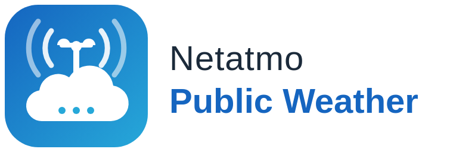

<picture>
  <source media="(prefers-color-scheme: dark)" srcset="docs/images/dark_logo.png">
  
</picture>

# Netatmo Public Weather

[English](README.md) | **Deutsch**

[](https://www.home-assistant.io/integrations/marketplace/#custom-repositories)
[](https://github.com/apisch/Netatmo-Public-Weather/releases)
[](LICENSE)
[](https://github.com/apisch/Netatmo-Public-Weather/issues)
[](https://www.home-assistant.io/)

[](https://my.home-assistant.io/redirect/marketplace_repository/?owner=apisch&repository=Netatmo-Public-Weather&category=integration)
(Home Assistant ab 2026.11)

[](https://my.home-assistant.io/redirect/hacs_repository/?owner=apisch&repository=Netatmo-Public-Weather&category=integration)
(HACS bei Home Assistant bis 2026.10)

Eine Home-Assistant-Integration, die **öffentliche Netatmo-Wetterstationen in deiner Nachbarschaft** in Wetter-Entitäten und Sensoren verwandelt. Eigene Netatmo-Hardware brauchst du nicht.

Du wählst eine bis drei Stationen in deiner Nähe aus. Die Integration liefert dir:

- **pro Station einen Wetter-Eintrag** mit Sensoren für Temperatur, Luftfeuchte, Luftdruck, Regen, Wind und Böen;
- einen **Primary**-Wetter-Eintrag, der deiner bevorzugten Station folgt und **komplett auf die nächste Station wechselt**, wenn sie nichts mehr meldet;
- einen **Average**-Wetter-Eintrag aus allen gesunden Stationen: Mittelwert für Temperatur, Luftfeuchte und Luftdruck, Höchstwert für Wind, Böen und Regen;
- optional **Zustand und Vorhersage von einem Wetter-Eintrag, den du schon hast**, etwa Met.no, DWD, OpenWeatherMap oder AccuWeather. Netatmo misst die aktuellen Werte, dein Vorhersagedienst ergänzt den Rest.

Veraltete Daten werden nie als aktuell angezeigt. Meldet eine Station nichts mehr, werden ihre Entitäten `nicht verfügbar`, und ein Sensor „Daten aktuell“ schaltet aus.

> [!WARNING]
> **Das ist kein Sturmschutz.** Die Daten stammen von der Station eines anderen, oft Hunderte Meter entfernt. Sie kommen 10 bis 20 Minuten verspätet in Home Assistant an, und die Station kann jederzeit verschwinden. Nutze sie für Komfort-Automationen, etwa die Markise bei Wind einzufahren oder nach Regen nicht zu bewässern. **Verlass dich nicht darauf, um Geräte vor plötzlichen Böen zu schützen.** Dafür brauchst du einen Windsensor an deinem Haus.

## Funktionen

- Einrichtung nur über die Oberfläche: Du meldest dich bei Netatmo an und übernimmst entweder die Stationen, die du auf der [Netatmo-Wetterkarte](https://weathermap.netatmo.com/) mit einem Stern markiert hast, oder du suchst rund um einen Ort. In beiden Fällen wählst du aus einer Liste nach Entfernung, mit Symbolen für die Messgeräte (🌡 Temperatur, 🌧 Regen, 💨 Wind) und der Höhe. Links öffnen jede Station auf der Netatmo-Wetterkarte, so siehst du Lage und Verlauf, bevor du dich entscheidest.
- Ausfallumschaltung mit Hysterese: Primary wechselt sofort weg, wenn eine Station ausfällt, und erst nach zwei guten Abrufen zurück.
- Optionaler Wetter-Eintrag als Quelle für Zustand, Vorhersagen (täglich, stündlich, zweimal täglich), UV-Index, Bewölkung, gefühlte Temperatur, Sichtweite und Ozon.
- Gemessener Regen schlägt das Vorhersagemodell: Misst eine Station Regen, ist der Zustand `rainy`, egal was die Quelle sagt.
- Taupunkt, berechnet aus Temperatur und Luftfeuchte.
- Die Einheiten folgen dem Einheitensystem von Home Assistant (°C/°F, km/h/mph, hPa/inHg, mm/in).
- Etwa 6 API-Abrufe pro Stunde, rund 1 % des Netatmo-Limits. Meldet Netatmo trotzdem das Limit, wartet die Integration von selbst länger.
- Eine Reparaturmeldung erscheint, wenn eine gewählte Station seit 7 Tagen verschwunden ist.
- Oberfläche und Doku auf Englisch und Deutsch.

## Installation

Benötigt **Home Assistant 2025.4 oder neuer**.

### Marketplace (Home Assistant ab 2026.11, empfohlen)

Seit Home Assistant 2026.11 ist HACS als **Marketplace** eingebaut. Dieses Repository steht nicht im Standardkatalog, du fügst es deshalb als eigenes Repository hinzu:

1. Klicke oben auf **Im Marketplace öffnen**, oder gehe zu **Einstellungen → Marketplace → Über Link hinzufügen (Add from link)** und gib `https://github.com/apisch/Netatmo-Public-Weather` mit dem Typ **Integration** ein.
2. Öffne **Netatmo Public Weather** und klicke auf **Installieren**.
3. Starte Home Assistant neu, falls danach gefragt wird, und mach mit dem [Schnellstart](#schnellstart) weiter.

Updates erscheinen unter **Einstellungen → Updates**. Die Release-Notizen stammen aus [CHANGELOG.md](CHANGELOG.md) (Englisch).

### HACS (Home Assistant bis 2026.10)

1. Klicke oben auf **Zu HACS hinzufügen**, oder öffne in HACS das Menü (⋮) → **Benutzerdefinierte Repositories** und füge `https://github.com/apisch/Netatmo-Public-Weather` mit dem Typ **Integration** hinzu.
2. Suche **Netatmo Public Weather**, installiere es und starte Home Assistant neu.

### Manuell

Kopiere `custom_components/netatmo_public_weather` aus dem [neuesten Release](https://github.com/apisch/Netatmo-Public-Weather/releases/latest) in den Ordner `custom_components` deiner Home-Assistant-Konfiguration und starte neu.

## Schnellstart

1. **Netatmo-App anlegen** (etwa 3 Minuten, einmalig): siehe [docs/de/netatmo-app.md](docs/de/netatmo-app.md). Du brauchst ihre **Client-ID** und ihr **Client-Secret**, und die Redirect-URI muss `https://my.home-assistant.io/redirect/oauth` sein.
2. Gehe in Home Assistant zu **Einstellungen → Geräte & Dienste → Integration hinzufügen → Netatmo Public Weather**. Gib Client-ID und Secret ein, wenn du gefragt wirst, und melde dich mit deinem Netatmo-Konto an.
3. **Wähle, woher die Stationen kommen:**
   - **Meine Netatmo-Favoriten:** Markiere vorher bis zu 5 öffentliche Stationen auf der [Netatmo-Wetterkarte](https://weathermap.netatmo.com/) mit dem Stern, angemeldet mit demselben Konto. Die Stationen werden einmalig übernommen; spätere Änderungen an deinen Favoriten ändern die Integration nicht.
   - **Stationen in der Nähe eines Ortes suchen:** Standard ist dein Zuhause mit einem Radius von 3 km.
4. **Wähle 1 bis 3 Stationen.** Nimm Stationen mit 🌧 und 💨, wenn du Regen und Wind brauchst.
5. **Lege die Reihenfolge fest.** Optional wählst du einen Wetter-Eintrag als Quelle für Zustand und Vorhersage.

Stationen, Reihenfolge, Quelle und Intervalle kannst du später über **Konfigurieren** an der Integration ändern, ohne sie neu einzurichten.

## Dokumentation

- [Netatmo-App anlegen](docs/de/netatmo-app.md)
- [Entitäten](docs/de/entities.md): was jede Entität bedeutet und wann sie nicht verfügbar ist
- [Ausfallumschaltung und Mittelwerte](docs/de/failover.md): die genauen Regeln
- [FAQ und Fehlersuche](docs/de/faq.md)

## Beispiel: Markise bei Wind einfahren

```yaml
automation:
  - alias: "Markise: bei Wind einfahren"
    triggers:
      - trigger: numeric_state
        entity_id: sensor.netatmo_meinort_ab_cd_primary_boengeschwindigkeit
        above: 35
      - trigger: state
        entity_id: binary_sensor.netatmo_meinort_ab_cd_primary_daten_aktuell
        to: "off"
        for: "00:20:00"
    actions:
      - action: cover.close_cover
        target:
          entity_id: cover.markise
```

Der zweite Auslöser fährt die Markise ein, wenn 20 Minuten lang keine Station frische Daten geliefert hat. So bleibt die Markise nie blind draußen. Deine Entitäts-IDs hängen von den Stationsnamen und der Sprache deines Home Assistant ab; du findest sie auf der Geräteseite.

## Entwicklung

Die Tests laufen in Docker, eine lokale Python-Umgebung ist nicht nötig:

```bash
docker build -t npw-test -f .devcontainer-test/Dockerfile .
docker run --rm -v "$PWD:/work" npw-test pytest -q
```

Nach Änderungen an `strings.json` erzeugst du die englische Übersetzung mit `python3 scripts/build_translations.py` neu und ziehst `translations/de.json` von Hand nach.

## Haftungsausschluss

Dieses Projekt steht in keiner Verbindung zu Netatmo und wird nicht von Netatmo unterstützt. Das Logo ist ein eigener Entwurf und verwendet keine Netatmo-Marken. Die Integration nutzt die öffentliche Daten-API, die Netatmo Entwicklern anbietet. Die Wetterdaten gehören den Stationsbesitzern, die sie teilen.

## Lizenz

MIT
