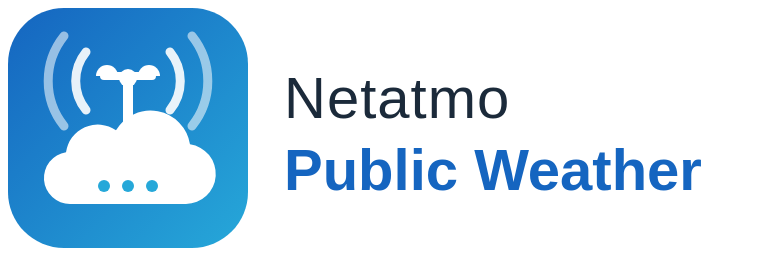

<picture>
  <source media="(prefers-color-scheme: dark)" srcset="docs/images/dark_logo.png">
  
</picture>

# Netatmo Public Weather

**English** | [Deutsch](README.de.md)

[](https://www.home-assistant.io/integrations/marketplace/#custom-repositories)
[](https://github.com/apisch/Netatmo-Public-Weather/releases)
[](LICENSE)
[](https://github.com/apisch/Netatmo-Public-Weather/issues)
[](https://www.home-assistant.io/)

<!-- ha-marketplace:exclude-start -->
[](https://my.home-assistant.io/redirect/marketplace_repository/?owner=apisch&repository=Netatmo-Public-Weather&category=integration)
(Home Assistant 2026.11+)

[](https://my.home-assistant.io/redirect/hacs_repository/?owner=apisch&repository=Netatmo-Public-Weather&category=integration)
(HACS on Home Assistant 2026.10 and older)
<!-- ha-marketplace:exclude-end -->

A Home Assistant integration that turns **public Netatmo weather stations in your neighbourhood** into weather entities and sensors. You don't need to own any Netatmo hardware.

Pick one to three stations near you. The integration gives you:

- **one weather entity per station**, with sensors for temperature, humidity, pressure, rain, wind and gusts;
- a **Primary** weather entity that follows your preferred station and **switches completely to the next station** if it stops reporting;
- an **Average** weather entity that combines all healthy stations: the mean for temperature, humidity and pressure, the maximum for wind, gusts and rain;
- optionally, **condition and forecast from any weather entity you already have**, such as Met.no, DWD, OpenWeatherMap or AccuWeather. Netatmo measures the current values; your forecast provider fills in the rest.

Stale data is never shown as current. If a station stops reporting, its entities become `unavailable` and a "Data fresh" sensor turns off.

> [!WARNING]
> **This is not a storm guard.** The data comes from someone else's station, often hundreds of metres away. It reaches Home Assistant 10 to 20 minutes late, and the station can disappear at any time. Use it for comfort automations, such as retracting the awning when it gets windy or skipping irrigation after rain. **Do not rely on it to protect equipment from sudden gusts.** For that, use a wind sensor mounted at your house.

## Features

- UI-only setup: you sign in with Netatmo and either take the stations you starred on the [Netatmo Weathermap](https://weathermap.netatmo.com/), or search around a place. Either way you choose from a list sorted by distance, with icons for their modules (🌡 temperature, 🌧 rain, 💨 wind) and their altitude. Links open each station on the [Netatmo Weathermap](https://weathermap.netatmo.com/), so you can check location and history before you decide.
- Failover with hysteresis. Primary switches away at once when a station fails, and switches back only after two good updates.
- Optional source entity for condition, forecasts (daily, hourly, twice daily), UV index, cloud coverage, apparent temperature, visibility and ozone.
- Measured rain beats the forecast model: if a station measures rain, the condition is `rainy` whatever the source says.
- Dew point calculated from temperature and humidity.
- Units follow your Home Assistant unit system (°C/°F, km/h/mph, hPa/inHg, mm/in).
- About 6 API requests per hour, about 1 % of Netatmo's limit. If Netatmo signals the limit anyway, the integration backs off automatically.
- A repair issue appears when a selected station has been gone for 7 days.
- English and German UI and documentation.

## Installation

Requires **Home Assistant 2025.4 or newer**.

<!-- ha-marketplace:exclude-start -->
### Marketplace (Home Assistant 2026.11+, recommended)

Since Home Assistant 2026.11, HACS is built in as the **Marketplace**. This repository is not in the default catalogue, so you add it as a custom repository:

1. Click the **Open in the Marketplace** button above, or go to **Settings → Marketplace → Add from link** and enter `https://github.com/apisch/Netatmo-Public-Weather` with the type **Integration**.
2. Open **Netatmo Public Weather** and click **Install**.
3. Restart Home Assistant if asked, then continue with the [Quick start](#quick-start).

Updates appear under **Settings → Updates**. The release notes come from [CHANGELOG.md](CHANGELOG.md).

### HACS (Home Assistant 2026.10 and older)

1. Click the **Add to HACS** button above, or in HACS open the menu (⋮) → **Custom repositories** and add `https://github.com/apisch/Netatmo-Public-Weather` with the type **Integration**.
2. Search for **Netatmo Public Weather**, install it and restart Home Assistant.
<!-- ha-marketplace:exclude-end -->

### Manual

Copy `custom_components/netatmo_public_weather` from the [latest release](https://github.com/apisch/Netatmo-Public-Weather/releases/latest) into the `custom_components` folder of your Home Assistant configuration, then restart.

## Quick start

1. **Create a Netatmo app** (about 3 minutes, once): see [docs/netatmo-app.md](docs/netatmo-app.md). You need its **client ID** and **client secret**, and the redirect URI must be `https://my.home-assistant.io/redirect/oauth`.
2. In Home Assistant, go to **Settings → Devices & services → Add integration → Netatmo Public Weather**. Enter the client ID and secret when asked, then sign in with your Netatmo account.
3. **Choose where the stations come from:**
   - **My Netatmo favourites:** star up to 5 public stations on the [Netatmo Weathermap](https://weathermap.netatmo.com/) beforehand (signed in with the same account). The stations are imported once; later changes to your favourites don't change the integration.
   - **Search near a place:** defaults to your home location and a radius of 3 km.
4. **Pick 1 to 3 stations.** Prefer stations that have both 🌧 and 💨 if you need rain and wind.
5. **Set the priority.** Optionally pick a weather entity as the source for condition and forecast.

You can change stations, priority, source and timing later under **Configure** on the integration, without setting it up again.

## Documentation

- [Creating the Netatmo app](docs/netatmo-app.md)
- [Entities](docs/entities.md): what each entity means and when it is unavailable
- [Failover and averaging](docs/failover.md): the exact rules
- [FAQ and troubleshooting](docs/faq.md)

The documentation is also available [in German](README.de.md#dokumentation).

## Example: retract the awning when it gets windy

```yaml
automation:
  - alias: "Awning: retract on wind"
    triggers:
      - trigger: numeric_state
        entity_id: sensor.netatmo_mytown_ab_cd_primary_gust_speed
        above: 35
      - trigger: state
        entity_id: binary_sensor.netatmo_mytown_ab_cd_primary_data_fresh
        to: "off"
        for: "00:20:00"
    actions:
      - action: cover.close_cover
        target:
          entity_id: cover.awning
```

The second trigger retracts the awning when no station has delivered fresh data for 20 minutes, so the awning is never left out blind. Your entity IDs depend on the station names and on the language of your Home Assistant; look them up on the device page.

## Development

The tests run in Docker, so no local Python setup is needed:

```bash
docker build -t npw-test -f .devcontainer-test/Dockerfile .
docker run --rm -v "$PWD:/work" npw-test pytest -q
```

After editing `strings.json`, regenerate the English translation with `python3 scripts/build_translations.py`, and update `translations/de.json` to match.

## Disclaimer

This project is not affiliated with or endorsed by Netatmo. The logo is an original design and does not use Netatmo's trademarks. It uses the public data API that Netatmo provides to developers. Weather data belongs to the station owners who choose to share it.

## License

MIT
