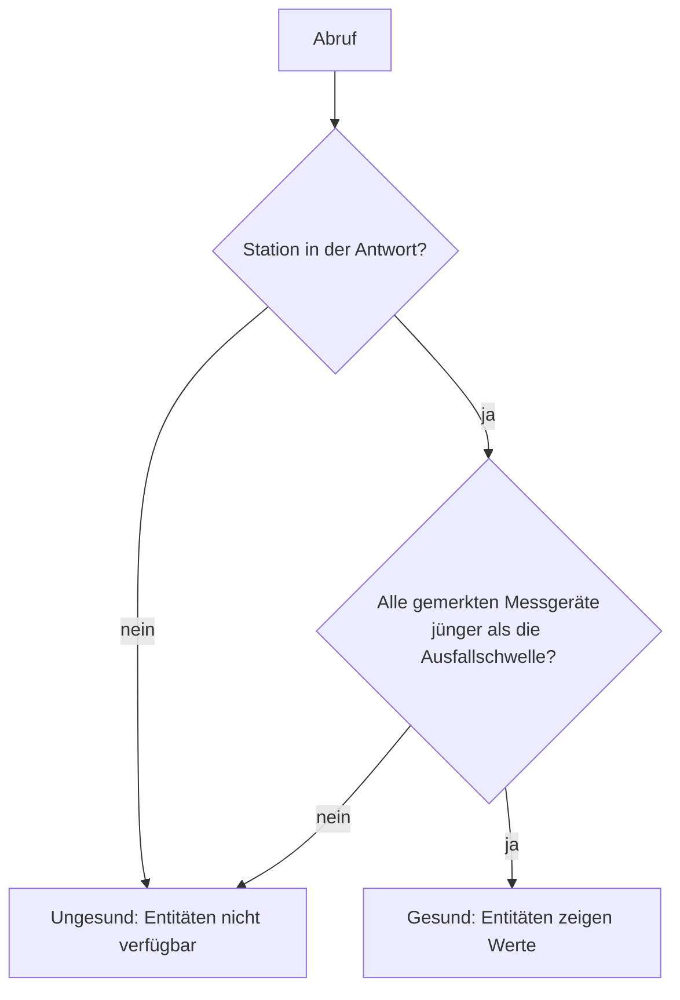

# Ausfallumschaltung und Mittelwerte

[English](../failover.md) | **Deutsch**

> [!WARNING]
> Öffentliche Netatmo-Daten kommen 10 bis 20 Minuten verspätet an und stammen von Stationen, auf die du keinen Einfluss hast. Die Regeln unten machen sie so verlässlich wie möglich, aber sie machen sie **nicht** zu einem Sturmschutz. Schütze Markisen und Ähnliches mit einem Windsensor am Haus.

## Abruf

In jedem Abrufintervall (Standard 10 Minuten, einstellbar von 5 bis 60) macht die Integration **einen** Abruf für einen kleinen Kartenausschnitt um alle gewählten Stationen. Fehlt eine Station in der Antwort, fragt sie ein weiteres Mal mit einem winzigen Ausschnitt um genau diese Station.

Netatmo-Stationen senden etwa alle 10 Minuten, häufigeres Abrufen bringt also selten neuere Daten.

Meldet Netatmo sein Rate-Limit, verdoppelt sich das Intervall nach jedem Fehlschlag, bis höchstens 60 Minuten. Nach dem ersten erfolgreichen Abruf gilt wieder das normale Intervall.

## Wann ist eine Station gesund?

Bei der Einrichtung merkt sich die Integration, welche Messgeräte eine Station hat (Außenmodul, Regenmesser, Windmesser). Bei jedem Abruf ist eine Station nur dann **gesund**, wenn **beides** zutrifft:

1. sie ist in der Antwort von Netatmo enthalten, und
2. **jedes** gemerkte Messgerät hat einen Messwert, der jünger ist als die *Ausfallschwelle* (Standard 30 Minuten, einstellbar von 15 bis 120).

Verstummt nur ein Messgerät, weil zum Beispiel die Batterien des Windmessers leer sind, gilt die ganze Station als ausgefallen. Das ist Absicht: Primary wechselt dann vollständig zur nächsten Station, seine Werte mischen also nie zwei Stationen.

## Primary: Reihenfolge mit Ersatz

Du legst eine Reihenfolge fest: Hauptstation, erster Ersatz, zweiter Ersatz.

- **Erste Wahl:** die erste gesunde Station in deiner Reihenfolge.
- **Aktive Station fällt aus:** **sofort** Wechsel zur ersten gesunden Station in deiner Reihenfolge.
- **Bessere Station ist wieder da:** Zurück geht es erst, wenn sie **2 Abrufe hintereinander** gesund war. Das verhindert Hin-und-her-Springen, wenn eine Station unregelmäßig sendet.
- **Keine Station gesund:** Alle Primary-Entitäten werden nicht verfügbar, und *Daten aktuell* schaltet auf `aus`.

Der Sensor *Aktive Station* zeigt, welche Station gerade genutzt wird, sein Attribut `priority` ihre Position (1 = Hauptstation).

### Beispiel

| Abruf | Hauptstation | Erster Ersatz | Aktiv |
|---|---|---|---|
| 1 | ✓ | ✓ | Hauptstation |
| 2 | ✗ Wind stumm | ✓ | Erster Ersatz |
| 3 | ✓ | ✓ | Erster Ersatz (erster guter Abruf) |
| 4 | ✓ | ✓ | Hauptstation (zweiter guter Abruf) |

## Average

Die Average-Entitäten nutzen **nur gesunde Stationen**:

| Wert | Regel | Warum |
|---|---|---|
| Temperatur, Luftfeuchte, Luftdruck | arithmetisches Mittel | gleicht eine schlecht aufgestellte Station aus |
| Windgeschwindigkeit, Böengeschwindigkeit | **Höchstwert** | beim Wind zählt der ungünstigste Fall in deiner Nähe |
| Regenintensität, Regen 1 h, Regen 24 h | **Höchstwert** | regnet es an einer Station, regnet es wahrscheinlich auch bei dir |
| Wind- und Böenrichtung | von der Station mit der stärksten Böe (oder dem stärksten Wind, wenn es keine Böen gibt) | die Richtung passt zur gemeldeten Stärke |

Ein Wert ist nur dann nicht verfügbar, wenn ihn keine gesunde Station misst.

## Zustand

Mit Quell-Wetter-Eintrag:
- der Zustand kommt von der Quelle;
- misst eine Station Regen (Intensität > 0) und die Quelle meldet etwas Trockenes, wird der Zustand `rainy`;
- nasse Zustände der Quelle (`pouring`, `snowy` und so weiter) bleiben erhalten.

Ohne Quelle:
- `rainy`, solange Regen gemessen wird;
- `windy` ab 39 km/h Wind oder ab 50 km/h Böen;
- sonst unbekannt.

Ist der Quell-Eintrag nicht verfügbar, verhält sich der Wetter-Eintrag, als wäre keine Quelle eingestellt. Er bleibt verfügbar.
