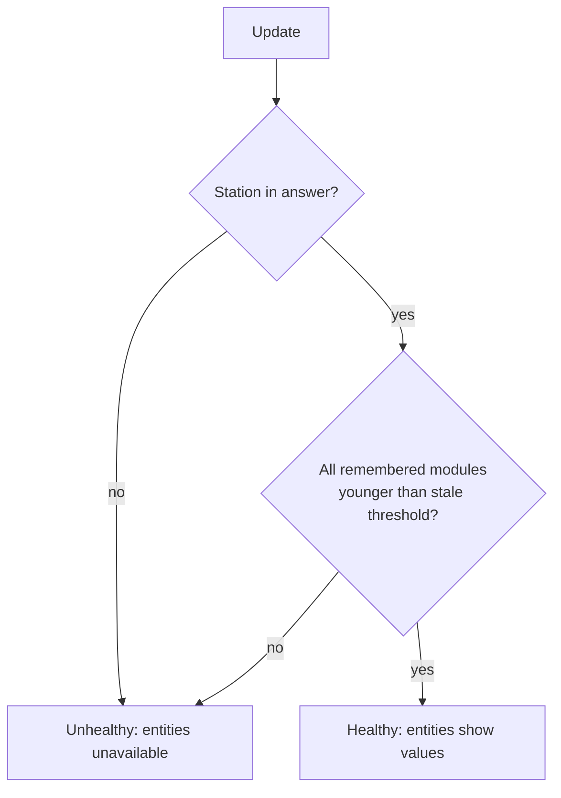

# Failover and averaging

**English** | [Deutsch](de/failover.md)

> [!WARNING]
> Public Netatmo data arrives 10 to 20 minutes late and comes from stations you don't control. The rules below make it as trustworthy as possible, but they do **not** make it a storm guard. Protect awnings and similar equipment with a local wind sensor.

## Polling

Every update interval (default 10 minutes, adjustable from 5 to 60), the integration makes **one** request for a small box around all configured stations. If a station is missing from the answer, it asks once more with a tiny box around that station.

Netatmo stations upload roughly every 10 minutes, so polling more often rarely brings newer data.

If Netatmo reports its rate limit, the interval doubles after each failure, up to 60 minutes. It returns to normal after the first successful update.

## When is a station healthy?

During setup, the integration remembers which modules a station has (outdoor module, rain gauge, wind gauge). On every update, a station is **healthy** only if **both** of these hold:

1. it is present in Netatmo's answer, and
2. **every** remembered module has a measurement younger than the *stale threshold* (default 30 minutes, adjustable from 15 to 120).

If only one module goes silent, for example the wind gauge's batteries run out, the whole station counts as down. This is deliberate: Primary then switches to the next station completely, so its values never mix two stations.

## Primary: priority with fallback

You set an order: primary station, first fallback, second fallback.

- **Initial pick:** the first healthy station in your order.
- **Active station fails:** switch **immediately** to the first healthy station in your order.
- **Better station recovers:** switch back only after it has been healthy for **2 updates in a row**. This prevents flapping when a station reports irregularly.
- **No station healthy:** all Primary entities become unavailable, and *Data fresh* turns `off`.

The *Active station* sensor shows which station is in use, and its `priority` attribute shows its position (1 = primary).

### Example

| Update | Primary station | Fallback 1 | Active |
|---|---|---|---|
| 1 | ✓ | ✓ | Primary station |
| 2 | ✗ wind silent | ✓ | Fallback 1 |
| 3 | ✓ | ✓ | Fallback 1 (first good update) |
| 4 | ✓ | ✓ | Primary station (second good update) |

## Average

The Average entities use **only healthy stations**:

| Value | Rule | Why |
|---|---|---|
| Temperature, humidity, pressure | arithmetic mean | smooths out a badly placed station |
| Wind speed, gust speed | **maximum** | the worst case near you is what matters for wind |
| Rain intensity, rain 1 h, rain 24 h | **maximum** | if it rains at one station, it probably rains at yours |
| Wind and gust direction | from the station with the strongest gust (or wind, if no gusts) | direction matches the reported strength |

A value is unavailable only if no healthy station measures it.

## Condition

With a source weather entity:
- the condition comes from the source;
- if a station measures rain (intensity > 0) and the source says something dry, the condition becomes `rainy`;
- wet conditions from the source (`pouring`, `snowy`, and so on) are kept.

Without a source:
- `rainy` while rain is measured;
- `windy` at 39 km/h or more wind, or 50 km/h or more gusts;
- otherwise unknown.

If the source entity is unavailable, the weather entity behaves as if no source were configured. It stays available.
